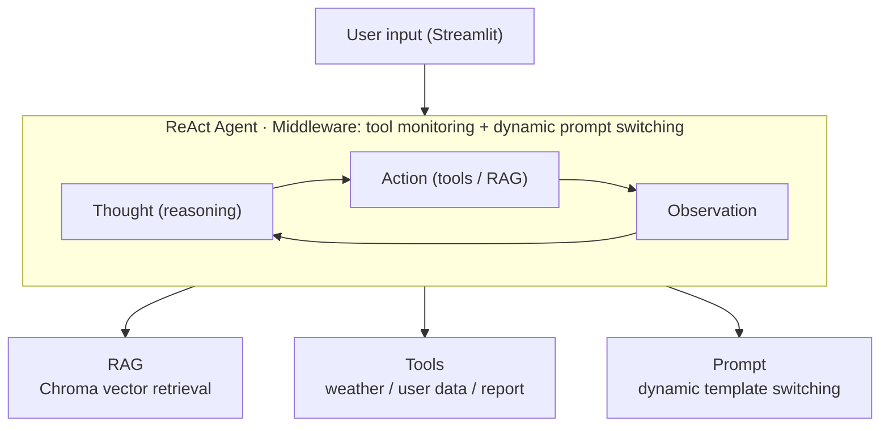

<div align="center">

# LangChain ReAct Agent

**A ReAct Agent customer-service system built on LangChain / LangGraph**

[](https://www.python.org/)
[](https://www.langchain.com/)
[](https://github.com/langchain-ai/langgraph)
[](https://streamlit.io/)
[](./LICENSE)

[中文](README.md) | [English](README.en.md)

</div>

---

## Introduction

A **ReAct (Reasoning + Acting)** agent implemented with LangChain, combining RAG retrieval, multi-tool calling and dynamic prompt switching. The agent infers the task type from user intent — knowledge Q&A or report generation — invokes the appropriate tools and knowledge base, and streams its full reasoning chain live in a Streamlit UI.

Demo scenario: customer service for a robot vacuum.

## Demo

<div align="center">
  
  <br>
  <em>Figure 1 · Standard Q&A — answering from the knowledge base via RAG</em>
</div>

<br>

<div align="center">
  
  <br>
  <em>Figure 2 · Tool calling — reasoning and tool execution shown in real time</em>
</div>

<br>

<div align="center">
  
  <br>
  <em>Figure 3 · Tool call details — multi-step reasoning with intermediate results</em>
</div>

## Architecture



### Features

| Feature | Description |
|---------|-------------|
| **ReAct paradigm** | Thought → Action → Observation loop; the agent reasons on its own and decides which tool to call |
| **RAG retrieval** | Chroma vector store + DashScope embeddings, MD5 file dedup, mixed txt/pdf loading |
| **Multi-tool calling** | Weather, user location, external data lookup and report context — selected on demand by the agent |
| **Dynamic prompt switching** | Middleware swaps between a standard Q&A system prompt and a report-generation prompt based on runtime context |
| **Streaming chat UI** | Built with Streamlit: token-by-token streaming, history retention, visible reasoning trace |
| **Modular structure** | Agent / RAG / Model / Tools / Middleware kept in separate modules, driven by YAML config |

## Tech Stack

| Layer | Technology |
|-------|------------|
| LLM | Tongyi Qianwen (DashScope / ChatTongyi) |
| Agent framework | LangChain + LangGraph |
| Vector database | Chroma |
| Document processing | PyPDF + RecursiveCharacterTextSplitter |
| Frontend | Streamlit |
| Configuration | YAML-driven (agent / RAG / Chroma / prompts) |

## Quick Start

### Requirements

- **Python** ≥ 3.10
- **DashScope API key** — request one from [Alibaba Cloud Model Studio](https://bailian.console.aliyun.com/)

### 1. Clone

```bash
git clone https://github.com/lhh737/LangChain-ReAct-Agent.git
cd LangChain-ReAct-Agent
```

### 2. Install dependencies

All dependencies are declared in `pyproject.toml` — pick one:

```bash
# Option 1: uv (recommended — creates .venv and uv.lock)
uv sync

# Option 2: pip + venv
python -m venv .venv
source .venv/bin/activate        # Windows: .venv\Scripts\activate
pip install .
```

### 3. Configure the API key

```bash
# Linux / macOS
export DASHSCOPE_API_KEY="your-api-key"

# Windows (CMD)
set DASHSCOPE_API_KEY=your-api-key
```

### 4. Initialise the knowledge base (first run)

```bash
python -c "from rag.vector_store import VectorStoreService; VectorStoreService().load_document()"
```

### 5. Run

```bash
streamlit run app.py
```

The browser opens at **http://localhost:8501**

### 6. Verify

Try these prompts after launching:

| Prompt | Exercises |
|--------|-----------|
| 扫地机器人有哪些主要功能？ | RAG knowledge-base Q&A |
| 如果机器人无法正常回充，该如何处理？ | Troubleshooting via retrieval |
| 请根据用户数据生成一份个性化使用报告 | Report generation + tool calling |

## Project Structure

```
LangChain-ReAct-Agent/
├── agent/                          # Agent core
│   ├── react_agent.py              #   ReAct agent logic (streaming execution)
│   └── tools/
│       ├── agent_tools.py          #   Tool functions (RAG / weather / user data / report)
│       └── middleware.py           #   Middleware (tool monitoring, dynamic prompt switching)
│
├── rag/                            # RAG retrieval
│   ├── vector_store.py             #   Chroma store · document loading · MD5 dedup
│   └── rag_service.py              #   Retrieval → LLM summarisation service
│
├── model/
│   └── factory.py                  # Model factory (ChatTongyi + DashScope embeddings)
│
├── config/                         # YAML configuration
│   ├── agent.yml                   #   Agent behaviour and tool settings
│   ├── chroma.yml                  #   Vector store and retrieval parameters
│   ├── prompts.yml                 #   Prompt template paths
│   └── rag.yml                     #   RAG model and parameters
│
├── prompts/                        # Prompt templates
│   ├── main_prompt.txt             #   Standard Q&A system prompt
│   ├── rag_summarize.txt           #   RAG summarisation prompt
│   └── report_prompt.txt           #   Report generation system prompt
│
├── utils/                          # Helpers
│   ├── config_handler.py           #   YAML config loading
│   ├── file_handler.py             #   File parsing (PDF/TXT)
│   ├── logger_handler.py           #   Logging
│   ├── path_tool.py                #   Path utilities
│   └── prompt_loader.py            #   Prompt loading
│
├── data/                           # Knowledge-base documents (robot vacuum)
├── assets/                         # Screenshots
├── app.py                          # Streamlit entry point
├── pyproject.toml
└── README.md
```

## Configuration

Settings are centralised in YAML files under `config/`:

| File | Contents |
|------|----------|
| `rag.yml` | Chat model name, embedding model name |
| `chroma.yml` | Persistence path, chunk size, retrieval top-k, supported file types |
| `prompts.yml` | Prompt template file paths |
| `agent.yml` | Agent timeout, external data paths |

For the first run, all you need is the **DashScope API key exported** and knowledge-base documents present in `data/`.

## License

MIT © [lhh737](https://github.com/lhh737)